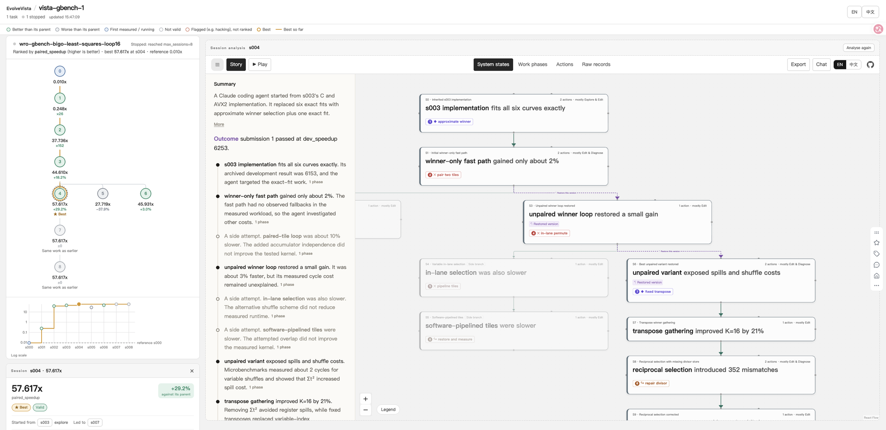

<div align="center">

# EvolveVista

**Watch an InfiniEvolve campaign evolve, live in the browser,<br>and open any of its sessions as a TraceVista analysis.**

[Quick start](#quick-start) · [What the page shows](#what-the-page-shows) · [Analyse a session](#analyse-a-session) · [How it works](#how-it-works) · [TraceVista](#tracevista) · [Developing](#developing-evolvevista)


</div>

<p align="center">
  
</p>

<p align="center"><sub>One task of a campaign: the lineage of its sessions, the best-so-far curve and the details of s004 on the left; s004's TraceVista analysis, its state map and story, on the right.</sub></p>

EvolveVista is the watch page of [InfiniEvolve](https://github.com/InfiniEvolve/InfiniEvolve). InfiniEvolve runs
coding-agent sessions one after another, each starting from earlier work, and archives every one; EvolveVista
reads that archive while the campaign runs, shows how each session compares with the one it started from, and
opens any session's trajectory in [TraceVista](https://github.com/InfiniEvolve/TraceVista). It never runs a
session or changes the campaign: the only files it writes are the analyses you ask for, under the campaign's
`vista/`.

## Quick start

Install the plugin once, from InfiniEvolve:

```sh
infinievolve install-watch      # into the Python that runs infinievolve; run it again to update
```

Then InfiniEvolve serves the page, for a campaign that is running or finished:

```sh
infinievolve run mytask --watch --open      # run the campaign and watch it
infinievolve watch mytask --open            # watch a campaign, running or finished
```

`mytask` is a task directory (`--name` picks which of its runs, `default` unless given) or a campaign directory.
Both commands take `--port` (default 8765), `--open`, `--analyst AGENT` (repeatable) and `--no-agents`. Open the
address printed: it carries the token the page needs.

## What the page shows

| | |
|---|---|
| **Tasks** | A campaign with several tasks shows them as tabs in the header, each with its state, number of sessions, best value and a small curve. The line under the campaign's name counts the tasks by state. More than six tasks get a filter. |
| **Lineage** | Every session as a circle, connected to the session it started from. Under it: the value it is ranked by, its change against that parent, and a note (best, running, same work as earlier). Running sessions appear as soon as they are submitted. |
| **Best-so-far curve** | Each session's value in archive order, the best reached so far, and the reference it is read against. A ratio metric spanning more than a factor of twenty is drawn on a log scale. |
| **Session details** | Click a circle or a point: its measurements, flags, timing, cost and the report the agent wrote open under the curve. Drag them out by the title bar to float beside the page; ⤓ puts them back. |
| **Analysis** | Drag a circle onto the analysis area for the session's TraceVista analysis. See [below](#analyse-a-session). |
| **Agent log** | Drag a session that is still running onto the analysis area to follow its agent as it works: what it says, the tools it calls and what they return, as each step is written. See [below](#follow-a-running-session). |

Colours read against the parent: **green** better, **grey** worse or unchanged, **blue** the first measured or
still running. A **gold** ring marks the best. A hollow grey circle is a session that is not valid; a hollow
**red** one was flagged (such as reward hacking) and is kept out of the ranking.

Everything except the analysis is read from the campaign's archive. No model is asked.

## Analyse a session

Drag a circle of the lineage onto the analysis area beside it. The page shows that session's TraceVista
analysis, the same state map the TraceVista skill makes, inside the TraceVista viewer. First the server extracts
the session's agent log (`raw/agent.jsonl`, or `raw/agent.log` in runs made by InfiniEvolve's local adapter
before it adopted that name) with the skill's `extract_timeline.py`: redacted, images omitted.
Then **Written by** picks who writes the analysis.

**An agent on the serving machine** (the default when one is available). It starts in
`<campaign>/vista/<task>/<session>/agent/`, which holds the whole skill, the extracted timeline, `check.py` and
the prompt `PROMPT.md`. It follows the skill: reads the timeline, looks up records with `show_events.py`, writes
`state-analysis.json` and runs `check.py` until it passes. When it ends, the server compiles its file with the
same checks. The page shows what the agent is doing, can stop it, and finds it again after a reload.

<details>
<summary>Which agents, how they are started, and what they may do</summary>

<br>

Each of these is offered when it is installed: Claude Code, Codex, Gemini CLI, Qwen Code, OpenCode, Cursor CLI,
GitHub Copilot CLI, Amp, Goose and Factory Droid. Each is started unattended as its documentation describes;
only Claude Code and Codex have been run this way here, and the page marks the others untested.

`--analyst` adds a particular model, or any other agent:

```sh
infinievolve watch mytask --analyst claude/claude-opus-5-5:high --analyst 'gemini=gemini --yolo -p "Follow the instructions on standard input."'
```

An analyst is `<agent>[/<model>[:<effort>]]` (`<agent>` is claude, codex, gemini, qwen, opencode, cursor,
copilot, amp, goose or droid; effort for claude and codex) or `<name>=<shell command>`, InfiniEvolve's way of
naming agents. Claude Code, Codex and shell commands get the prompt on standard input; the others an
instruction to read `PROMPT.md` (its path is also in `TRACEVISTA_PROMPT`).

`check.py` lists every structural problem at once, then runs `build_state_graph.py --require-reading-layer` and
lists the reading-quality gaps.

What each may do:

- Claude Code may edit files in its directory and run `python3` and read-only commands, nothing else.
- Codex runs in its `workspace-write` sandbox.
- The others run with their documented unattended approvals, as you: Gemini and Qwen `--yolo`, OpenCode
  `--auto`, Cursor `--force`, Copilot `--allow-all-tools`, Amp `--dangerously-allow-all`, Goose
  `GOOSE_MODE=auto`, Droid `--auto medium`.
- An agent given by a shell command runs as you, unconfined.

`--no-agents` offers none.

</details>

**A model asked from the browser**, with your own key, in the same settings as the trajectory chat. Requests go
from the browser to the provider; the key stays in the browser. When the server's checks object, the page sends
every problem back and asks for a corrected answer, until it compiles or you stop it; it shows the tokens used
so far.

The result is kept under `<campaign>/vista/<task>/<session>/` and opens at once the next time the session is
dropped there; **Analyse again** starts anew. A session without an agent log, such as the baseline, has nothing
to analyse.

## Follow a running session

A session that is still running has no complete trace to analyse yet. Dropped on the analysis area, it shows its
agent log instead, as the agent writes it (`raw/agent.jsonl`): the agent's text, its thinking where the log
keeps it, each tool call with its command or file, each result (cut to 1,500 characters) and every error, a
subagent's steps indented. The view follows the newest step unless you scroll up; **Jump to the latest** follows
it again. The page keeps the last 2,000 steps; a new view of a long log starts from its last 400.

The log is redacted with the TraceVista skill's own patterns, those its timeline extraction uses, and the values
of the server's own credentials (environment variables named like a token, key, secret or password) never
appear. Analysing waits for the session to end; when it does, the log stays in view with **Analyse it**. A
finished session can show its log too: **Analysis** and **Agent log** above the area switch between them.


**Reading a campaign.** The page reads a campaign with InfiniEvolve's own snapshot (`infinievolve.snapshot`),
so it shows the campaign exactly as the loop wrote it. A campaign in the older infra-evolve layout, which
InfiniEvolve's snapshot does not read, opens with `evolve-vista <campaign>`, the same server with EvolveVista's
own reader (`evolve_vista/campaign.py`).

**Live, without polling.** The page keeps one connection to the server, and the server pushes a new snapshot
only when the campaign changed: a session submitted, archived, re-measured or flagged. To notice, it compares
the modification times of the files it reads once a second. **Freeze view** closes the connection so the page
holds still while you read; the campaign keeps running. It is hidden once every task has stopped.
A running session's agent log comes the same way, on a second connection while it is open: the server reads the
log from where it last stopped, once a second, and sends only whole new lines.

**Confined.** The server binds to 127.0.0.1 only, reads the campaign directory and writes only the analyses
under `vista/`, and answers only the page that carries the token in the printed address. It starts an agent
only when you ask for one. It needs Python 3.10 or newer and no packages.

## TraceVista

[TraceVista](https://github.com/InfiniEvolve/TraceVista) is a git submodule in `third_party/TraceVista`, used as it
is, never copied into this repository:

- the page imports its graph model, model providers, language switch and styles from its source
  (`@tracevista/...` in `viewer/`), and the skill's references (`@tracevista-skill/...`);
- `npm run build` runs TraceVista's own build and puts its trajectory viewer, which an analysis opens in, beside
  the page in `evolve_vista/static/`;
- the server runs the skill's scripts (extract, compile, validate) from the submodule, and an analysing agent
  gets the whole skill. An installed package carries a copy that `npm run build` makes.

To follow TraceVista:

```sh
git submodule update --remote third_party/TraceVista   # its main branch
npm run build && npm test
git add -A third_party evolve_vista                    # the new TraceVista commit and the build
git commit -m "Follow TraceVista"
```

The page is in English and Chinese. Its own strings are in `viewer/src/i18n.zh.json`; the rest come from
TraceVista's table.

## Developing EvolveVista

The built page is committed (`evolve_vista/static/` and `evolve_vista/tracevista_skill/`), so installing needs
no Node. To change the page, in a checkout with its submodule:

```sh
git submodule update --init                         # TraceVista
npm install
infinievolve install-watch --from .                 # this checkout, editable, into InfiniEvolve's Python
npm run build && npm test                           # after each change; commit the build with the source
```

`npm test` covers the page's layout and comparisons, its translations, and the server. With InfiniEvolve
installed in the same environment, `tests/test_with_infinievolve.py` also runs the page on a real campaign,
InfiniEvolve's golf example (`PYTHON=path/to/python npm test` picks the interpreter).

## Licence

MIT. TraceVista is MIT licensed by its authors; `evolve_vista/static/TRACEVISTA-LICENSE` and
`evolve_vista/static/SOURCE.json` record what a build took from it and at which commit.
